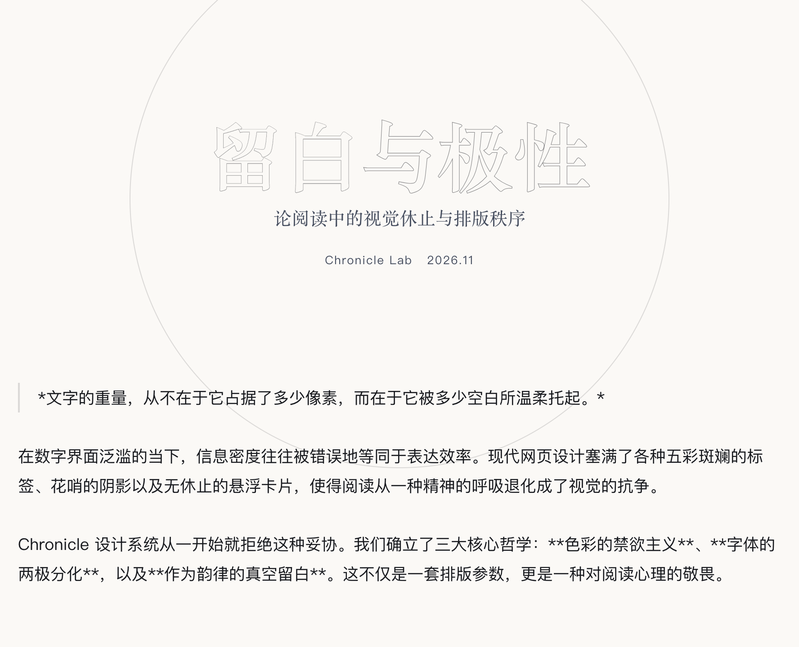
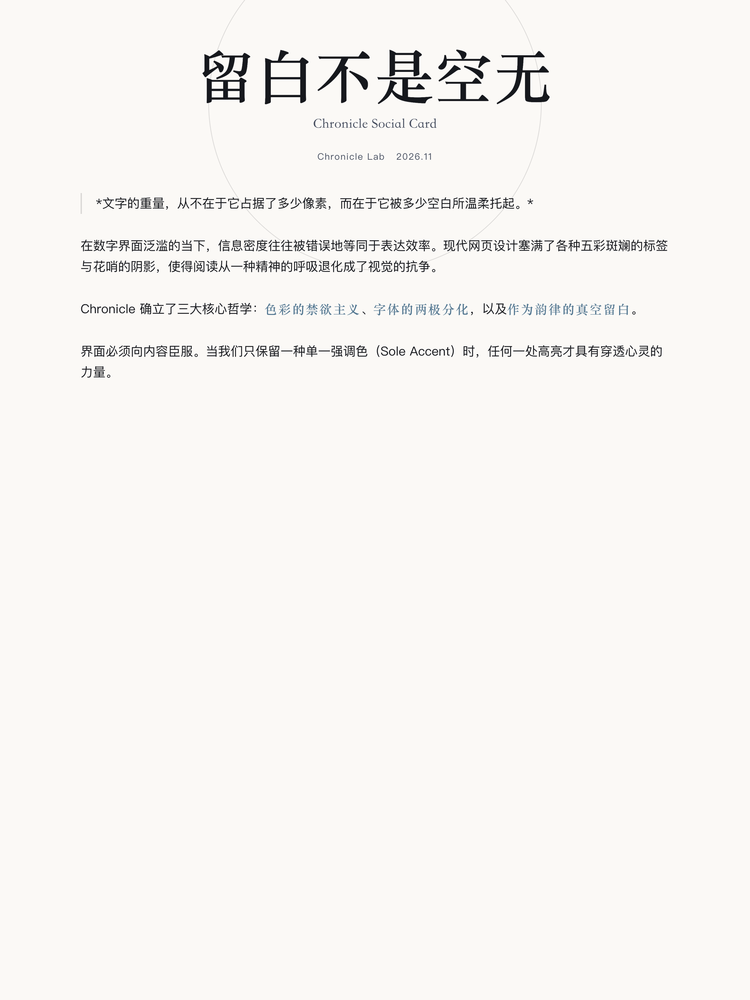
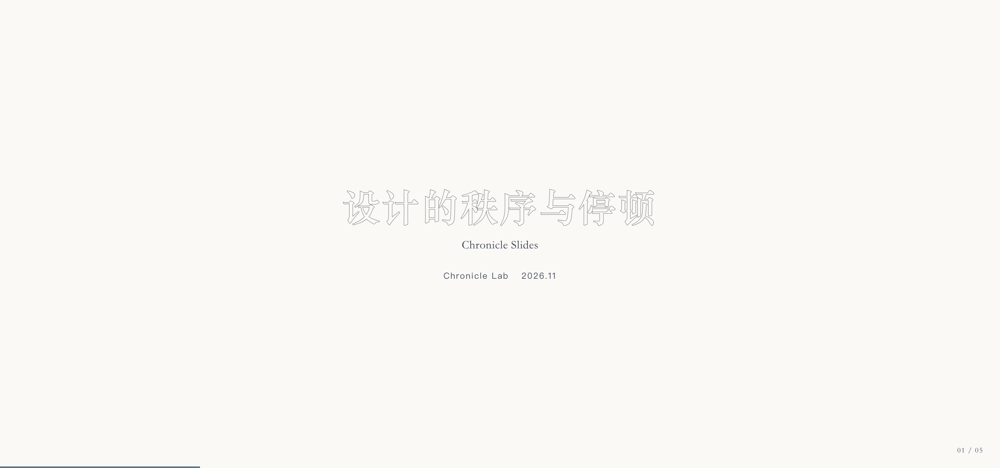
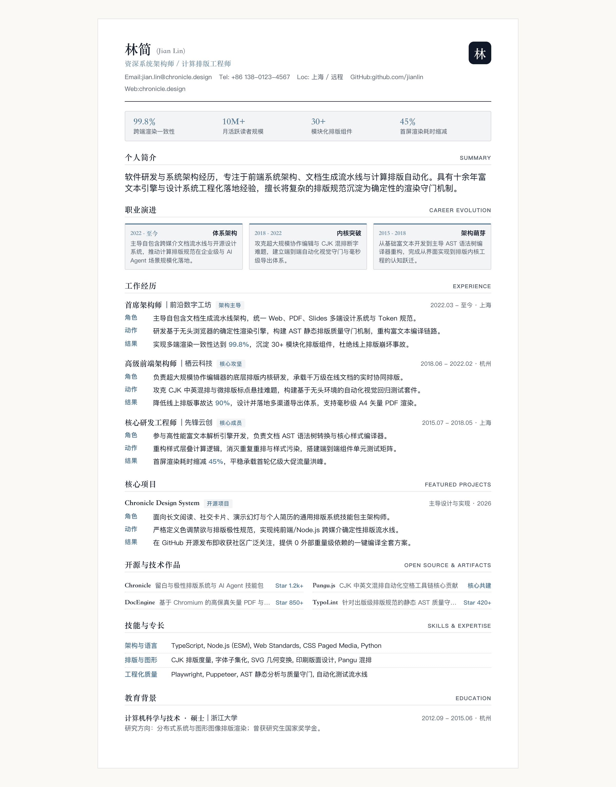

# Chronicle · 留白与极性排版系统

> **A visual and typographic design system engineered for long-form content, presentations, and print media.**  
> 面向长文排版、社交卡片、演示幻灯与个人简历的设计系统及 Agent Skill。  
> 
> **项目仓库**: [https://github.com/OwenCedaric/Chronicle](https://github.com/OwenCedaric/Chronicle)

-----

## 0 · 设计哲学 (Design Philosophy)

> “文字的重量，从不在于它占据了多少像素，而在于它被多少空白所温柔托起。”

1. **色彩的禁欲主义 (Chromatic Austerity)**：界面向内容让渡。系统使用中性底色基底（Base Surface）与单一强调色（Sole Accent），不引入红黄绿等警告色与杂色。
2. **字体的两极分化 (Typographic Polarity)**：衬线体（Noto Serif SC）承载思辨的庄严、停顿与标题分量；非衬线体（Noto Sans SC）承载正文的叙事流动性。二者界限明确。
3. **作为韵律的真空留白 (Vacuum as Rhythm)**：物理层面的大面积留白是阅读心理的停机坪。留白不是空无，而是呼吸与节奏本身。

-----

## 1 · 媒介形态与规格 (Formats & Dimensions)

| 媒介形态 | 比例 / 规格 | 核心排版规则 | 产出物 |
| :--- | :--- | :--- | :--- |
| **Page (长文阅读)** | 自适应长图 (`--aspect long`) | 核心阅读区宽度限制为 896px；1.85 叙事行高；提供题记（Epigraph）、破折线（Section Break）、中轴双人对话框（Chat Box）与尾声（Coda）。 | 单文件 HTML、2x 视网膜长图 PNG、A4 矢量 PDF |
| **Social Card (社交卡片)** | **3:4** (小红书)<br>**1:1** (微信方图)<br>**21:9** (公众号头图)<br>**16:9** (横版封面) | 继承 Chronicle 克制风格；支持指定画幅裁剪或批量导出（`--aspect all`），按比例适配图文内外间距。 | 对应规格的 2x PNG 卡片 (如 1080x1440, 1200x1200, 2100x900) |
| **Slides (演示幻灯)** | **16:9** 宽屏画幅 | 每页不超过三种颜色；字重 300 细体与 1.8 行距；溢出文字直接裁剪；支持键盘与全屏控制。 | 交互式单文件演示 HTML、16:9 矢量幻灯片 PDF |
| **Resume (个人简历)** | **A4** 规格纸张 | 融合出版级纪律与招聘官扫读心理。纯白底色与深墨黑正文（400 字重，1.55 紧凑行距）；配备四列核心战绩栏、认知跃迁进化弧、三段式结构化经历（角色/动作/结果与指标高亮）、出版商印章与开源专长矩阵。 | A4 矢量 PDF、预览 HTML、长图 PNG |

-----

## 2 · 案例展示 (Showcase)

以下为基于 Chronicle 规范导出的实际案例效果：

| 长文阅读 (Page) | 社交图文卡片 (Card 3:4) | 演示幻灯 (Slides 16:9) | 个人简历 (Resume A4) |
| :---: | :---: | :---: | :---: |
| <a href="site/demos/sample.html"></a> | <a href="site/demos/social-card-sample-3-4.png"></a> | <a href="site/demos/slides-sample.html"></a> | <a href="site/demos/resume-sample.html"></a> |
| [查看长文成品](site/demos/sample.html) | [查看卡片大图](site/demos/social-card-sample-3-4.png) | [体验在线演示](site/demos/slides-sample.html) | [查看简历预览](site/demos/resume-sample.html) |

-----

## 3 · 安装到 AI Agent (Skills CLI)

Chronicle 遵循标准 Agent Skill 协议。可通过 `skills` CLI 将其安装到当前环境的 AI 编程工具（Claude Code, Cursor, Codex 等）：

```bash
# 安装到全局环境
npx skills add OwenCedaric/Chronicle -a claude-code codex cursor -g -y

# 或安装到当前工作区
npx skills add OwenCedaric/Chronicle
```

安装完成后，在 Agent 中可直接调度：
> “使用 Chronicle 风格，把这篇文章排版成 3:4 小红书图文卡片”  
> “用 Chronicle 风格制作一份 16:9 幻灯片”  
> “用 Chronicle 规范导出带注头和页码的 A4 矢量 PDF”

-----

## 4 · 排版规范检查 (Hard Constraints)

导出前，检查脚本 (`lint.mjs`) 会核对排版规则，确保输出符合设计定义：

1. **左对齐约束 (Alignment)**：正文保持左对齐（flush-left, ragged-right），不使用两端对齐，避免拉扯字间空白。
2. **单强调色约束 (Chromatic Austerity)**：除单一强调色（`#82a1b9` / `#9cb4cd`）外，不引入其他彩色。
3. **正文字重约束 (Body Weight)**：叙事长文正文字重保持为 `300` Light 或 `400` Regular；简历正文采用 `400` Regular 确保招聘扫读清晰度，标题与指标采用 `700` 粗体。
4. **行高底线保证 (Line-Height)**：Page 正文行高 $\ge 1.80$；Slides 行高 $\ge 1.75$；Resume 行高锁定 `1.55`（底线 $\ge 1.50$），兼顾信息密度与视觉呼吸。
5. **避免阴影滥用 (No Drop Shadows)**：正文阅读流内不使用物理投影（左对话气泡微阴影除外）。
6. **视野宽度限制 (Visual Field Ceiling)**：Page 正文容器宽度 $\le 896\text{px}$，横向保留至少 24px 安全间隙。
7. **中英文字距排版 (CJK-Latin Spacing)**：中文字符与英文字母/半角数字间保留空格。

-----

## 5 · 命令行使用指南 (CLI Usage)

### 环境要求
- **Node.js** >= 20.0.0
- **Google Chrome** 或 Chromium

```bash
git clone https://github.com/OwenCedaric/Chronicle.git
cd Chronicle && pnpm install
```

### 1. 编译与导出 (`deliver`)

```bash
# 1. 编译长文排版（输出自适应长图与 A4 PDF）
node skills/chronicle/scripts/deliver.mjs article.md

# 2. 导出指定比例的社交图文卡片
node skills/chronicle/scripts/deliver.mjs article.md --aspect 3:4   # 小红书卡片 (1080x1440)
node skills/chronicle/scripts/deliver.mjs article.md --aspect 1:1   # 微信方图卡片 (1200x1200)
node skills/chronicle/scripts/deliver.mjs article.md --aspect 21:9  # 公众号头图 (2100x900)
node skills/chronicle/scripts/deliver.mjs article.md --aspect 16:9  # 视频横版封面 (1920x1080)
node skills/chronicle/scripts/deliver.mjs article.md --aspect all   # 批量生成全部尺寸 (3:4, 1:1, 21:9, 16:9)

# 3. 导出演示幻灯片（输出网页演示稿与 16:9 PDF）
node skills/chronicle/scripts/deliver.mjs slides.md --format slides

# 4. 导出个人简历（输出 HTML 与 A4 PDF）
node skills/chronicle/scripts/deliver.mjs resume.md --format resume

# 5. 生成深浅自适应 Chronicle Favicon (SVG 矢量 + 多分辨率 PNG)
node skills/chronicle/scripts/favicon.mjs --char C --out-dir site --png

# 6. 生成极简 GitHub Profile README 与自适应 SVG 镂空横幅
node skills/chronicle/scripts/profile.mjs --name "CEDAR" --title "Systems Architect" --out-dir profile

# 可选参数
#   --theme light|dark     指定浅色或深色主题
#   --out-dir <path>       指定产物输出目录（默认 output/）
#   --png / --no-png       是否导出图片
#   --pdf / --no-pdf       是否导出 PDF
```

### 2. 分步调用
```bash
# 编译 HTML
pnpm run render input.md [annotations.json] output.html --format page

# 执行排版规则检查
pnpm run lint output.html

# 执行导出
pnpm run export output.html --png output.png --pdf output.pdf
```

-----

## 6 · 目录结构 (Repository Structure)

```
Chronicle/
├── ChronicleDesignSystem.md          # 设计系统规范文档
├── README.md                         # 项目指南与开发手册
├── package.json                      # 根目录 NPM 配置
├── site/                             # 可部署的在线介绍与作品展示官网
│   ├── index.html                    # 官网首页（完全自包含、响应式、暗色支持）
│   ├── favicon.svg                   # 自适应深浅主题的矢量 Favicon
│   ├── demos/                        # 线上可直接访问的静态演示产物库
│   └── vercel.json                   # 部署配置 (Vercel / Cloudflare Pages 适用)
├── skills/
│   └── chronicle/                    # 【核心 Agent 技能包】
│       ├── SKILL.md                  # Agent Skill 协议入口与提示词手册
│       ├── CHEATSHEET.md             # Agent 快速速查表
│       ├── VERSION                   # 技能版本号 (0.1.0)
│       ├── LICENSE                   # MIT 开源协议
│       ├── package.json              # 技能独立依赖配置
│       ├── references/
│       │   ├── tokens.json           # 机器可读的色值/字阶/留白 Token
│       │   └── schemas/              # 语义升格 Schema 规范
│       ├── templates/
│       │   ├── page.html             # 长文 HTML 骨架
│       │   ├── slides.html           # 幻灯片 HTML 骨架 (带键盘控制)
│       │   ├── resume.html           # 简历 HTML 骨架
│       │   └── styles/               # 各媒介核心样式库 (含卡片模式)
│       └── scripts/
│           ├── pangu.mjs             # 盘古空格注入
│           ├── render.mjs            # 确定性多格式编译器
│           ├── lint.mjs              # 排版规则静态检查门禁
│           ├── export.mjs            # Chromium 管道化导出引擎 (长图 & 比例裁剪)
│           ├── deliver.mjs           # 编译与导出脚本
│           ├── favicon.mjs           # 极简主题自适应 Favicon 生成器
│           └── profile.mjs           # GitHub Profile README 与自适应 SVG 横幅生成器
├── examples/                         # 示例文件 (Page, Slides, Resume, Social Card)
└── output/                           # 编译导出交付件 (被 gitignore)
```

-----

## 7 · 许可证 (License)

MIT License. Designed with reverence for reading psychology and typography.
